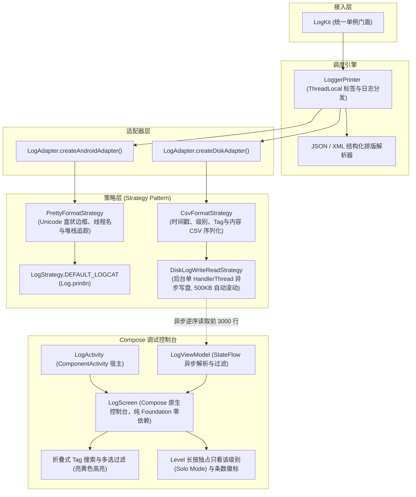

# LogKit (Android)

<p align="center">
  <b>纯 Kotlin 打造、Jetpack Compose 原生驱动的 Android 边端日志框架与应用内调试控制台</b>
</p>

<p align="center">
  <a href="https://jitpack.io/#e-hai/LogKit"></a>
  
  
  
  <a href="https://github.com/e-hai/LogKit-iOS"></a>
  <a href="LICENSE"></a>
</p>

> 💡 **跨平台版本**：LogKit 同时提供 100% 架构与交互对齐的 iOS 原生版本 👉 [LogKit-iOS (Swift / SwiftUI)](https://github.com/e-hai/LogKit-iOS)。

---

## 📐 架构设计



---

## ✨ 核心特性

- 🚀 **100% 纯 Kotlin & Compose 原生**：极简 10-File 架构，纯 Compose Foundation 构建，**零 Material3 / 零 Material 依赖**，彻底杜绝宿主版本冲突与 `NoSuchMethodError`。
- 🔍 **可折叠内联 Tag 搜索与多选组合**：主界面一键折叠/展开搜索框，支持多 Tag 组合勾选过滤，匹配关键字自动应用**亮黄色高亮**（`#FFFFD54F`）。
- 🎯 **Level 级别长按独占模式（Solo Mode）**：长按 `E` 芯片一秒快速切换为“只看 Error”，避免排查错误时逐个反选的繁琐操作；显示实时条数徽标。
- 🏷️ **活动标签吸顶栏**：已选 Tag 以带 `✕` 的独立胶囊展示，点击一秒移除，并支持一键清空全部已选标签。
- 📁 **异步 HandlerThread 磁盘持久化**：专属单后台线程异步写盘，完全不阻塞 UI，单文件达到 500KB 自动分卷滚动（`logs_*.csv`），控制台逆序高效读取最近 3000 行。
- ☀️/🌙 **明/暗双主题与沉浸式状态栏**：一键切换暗黑极客模式 (`#121212`) 与清爽日间模式 (`#F5F5F5`)，系统状态栏图标亮度实时自动同步。
- 📋 **便捷复制**：点击任意日志卡片直接将格式化日志复制至系统剪贴板。

---

## 🛠️ 第三方接入与依赖配置

### 步骤 1：添加 JitPack Maven 仓库

#### 推荐：在 `settings.gradle` 中添加
```groovy
dependencyResolutionManagement {
    repositoriesMode.set(RepositoriesMode.FAIL_ON_PROJECT_REPOS)
    repositories {
        google()
        mavenCentral()
        maven { url 'https://jitpack.io' } // 👈 添加 JitPack 仓库
    }
}
```

### 步骤 2：添加依赖

#### 方式 A：Version Catalog (`gradle/libs.versions.toml`) (推荐)
```toml
[versions]
logkit = "1.0.1"

[libraries]
logkit = { group = "com.github.e-hai", name = "LogKit-Android", version.ref = "logkit" }
```
在模块 `build.gradle` 中引入：
```groovy
dependencies {
    implementation libs.logkit
}
```

#### 方式 B：Groovy DSL (`build.gradle`)
```groovy
dependencies {
    implementation 'com.github.e-hai:LogKit-Android:1.0.1'
}
```

#### 方式 C：Kotlin DSL (`build.gradle.kts`)
```kotlin
dependencies {
    implementation("com.github.e-hai:LogKit-Android:1.0.1")
}
```

---

## 💡 快速上手使用

### 1. 初始化 (Application)
在自定义 `Application` 的 `onCreate()` 中进行初始化：

```kotlin
import android.app.Application
import com.kit.log.LogKit

class MyApp : Application() {
    override fun onCreate() {
        super.onCreate()

        // 推荐：全功能初始化 (Logcat 美化打印 + 本地磁盘持久化，支持应用内控制台)
        LogKit.initAllLog(this)

        // 或：仅初始化系统 Logcat 打印 (不持久化到磁盘)
        // LogKit.initOnlyAndroidLog()
    }
}
```

### 2. 日志打印使用

```kotlin
import com.kit.log.LogKit

// 1. 基础日志打印 (各级别)
LogKit.v("TAG", "详细跟踪日志")
LogKit.d("TAG", "调试信息")
LogKit.i("TAG", "普通提示信息")
LogKit.w("TAG", "警告信息")
LogKit.e("TAG", "错误信息")
LogKit.wtf("TAG", "断言严重错误")

// 2. 省略 Tag 打印 (默认 Tag 为 "LogKit")
LogKit.d("直接输出一条调试信息")

// 3. 链式设置单次临时 Tag (打印后自动清除，不污染线程)
LogKit.t("CUSTOM_TAG").d("使用临时 Tag 输出日志")

// 4. 异常堆栈打印
try {
    throw RuntimeException("网络请求失败")
} catch (e: Exception) {
    LogKit.e("NETWORK", e, "执行接口调用发生异常")
}

// 5. 结构化 JSON 与 XML 自动美化排版
LogKit.json("{\"user\": \"Developer\", \"status\": \"success\", \"code\": 200}")
LogKit.xml("<config><theme>dark</theme><debug enabled=\"true\"/></config>")
```

### 3. 唤起应用内调试控制台

在悬浮窗、设置页面“连续点击版本号”、摇一摇或调试按钮中调用：

```kotlin
// 传入当前 Activity 即可全屏打开控制台
LogKit.showLogUi(activity)
```

---

## 📱 控制台高效交互技巧

1. **Tag 搜索与多选**：点击顶部右上角 `🔍` 展开内联搜索框，输入关键字实时模糊匹配 Tag，支持同时勾选多个关联模块（如 `NETWORK` + `AUTH` 并排查看）。
2. **长按独占级别（Solo Mode）**：长按级别芯片（如长按 `E`）一秒直达“只看 Error”模式；再次长按或点击 `ALL` 恢复全选。
3. **活动 Tag 快速移除**：选中的 Tag 会作为带 `✕` 的活动胶囊停靠在顶栏下方，点击单个 `✕` 即可将其从过滤集合中移除，点击 `清空` 一键还原全部日志。
4. **手动折叠控制栏**：点击右上角折叠箭头 `▲`，可收起整个控制栏进入 100% 全屏日志模式；收起后点击右上角浮动按钮随时唤回。
5. **点击卡片一键复制**：点击任意日志卡片，整条日志（含时间戳、级别、Tag 和正文）将自动复制到系统剪贴板。

---

## 🏃 运行 Demo 工程

本项目内置完整的演示工程 `:sample`：
1. 用 Android Studio 打开当前工程；
2. 顶部 Run Configuration 选择 **`sample`**；
3. 点击 **▶️ Run** 运行到真机或模拟器即可体验与 iOS 镜像对齐的完整 Demo 主页面。

---

## 📄 开源协议
Apache License 2.0
