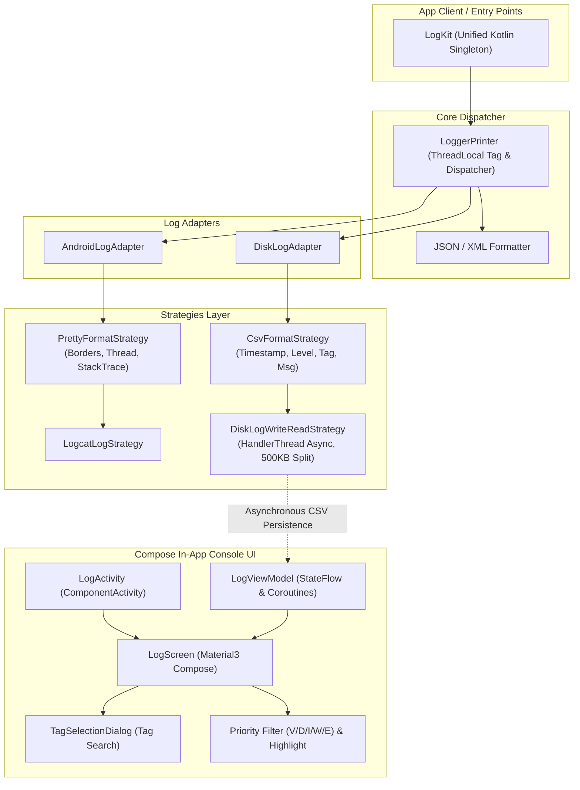

# LogKit

**LogKit** is a powerful, Kotlin-first, Jetpack Compose-native, pretty and customizable logger for Android with an integrated mobile log-inspection UI console.

---

## 📐 Architecture Overview



---

## ✨ Features

- 🚀 **Kotlin & Jetpack Compose Native**: Pure Kotlin implementation with a dark-themed Material3 Compose log console.
- 🎨 **Pretty Output**: Beautiful logcat formatting with thread info, stack traces, and clean borders.
- 📁 **Async Disk Persistence**: Asynchronous `HandlerThread` file persistence with automatic 500KB file splitting and retrieval of recent 3000 log lines.
- 🎯 **Priority Multi-Select Filter**: Interactive `V`, `D`, `I`, `W`, `E` priority filters with brand color badges.
- 🔍 **Tag Search & Highlighting**: Dedicated grid-based Tag search dialog with real-time keyword background highlighting (`Color(0xFFFFD54F)`).
- 📦 **Gradle Version Catalog**: Built with modern `libs.versions.toml` dependency management.

---

## 🛠 Setup

Initialize LogKit in your Application or Activity:

```kotlin
// Initialize both Android Logcat and Disk Logging with Compose UI support
LogKit.initAllLog(context)

// Or initialize only Android Logcat
LogKit.initOnlyAndroidLog()
```

---

## 💡 Usage

```kotlin
// Basic logging
LogKit.d("Hello LogKit")
LogKit.d("NETWORK", "Fetching user data...")
LogKit.i("TAG", "Info message")
LogKit.w("TAG", "Warning message")
LogKit.e("TAG", "Error message")

// Tag chain support
LogKit.t("CUSTOM_TAG").d("Chain tag message")

// Format JSON / XML
LogKit.json("{\"user\": \"LogKit\", \"status\": \"active\"}")
LogKit.xml("<config><item name=\"debug\">true</item></config>")
```

### Open In-App Log Inspection Console UI

```kotlin
LogKit.showLogUi(activity)
```

---

## 📄 License
Apache License 2.0
