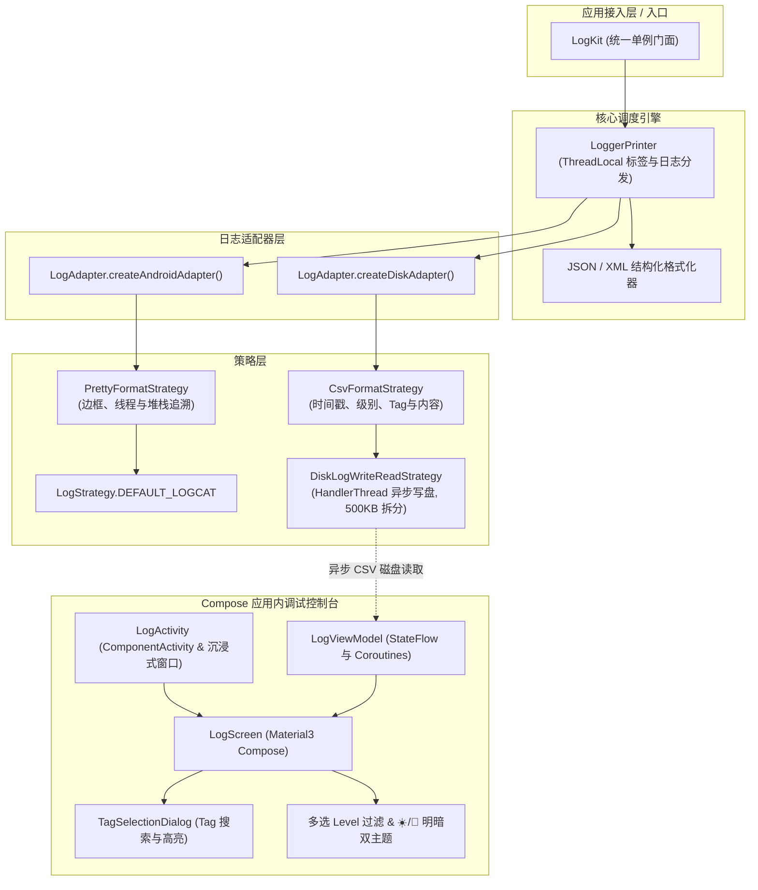

# LogKit

**LogKit** 是一款纯 Kotlin 打造、Jetpack Compose 原生驱动的 Android 边端日志框架，内置极简美观、支持明暗双主题与高效筛选的应用内日志调试控制台。

---

## 📐 架构设计图示



---

## ✨ 核心特性

- 🚀 **100% 纯 Kotlin & Compose 原生**：极简 10-File 架构，采用 Material3 打造高颜值端侧控制台。
- 📁 **异步 HandlerThread 磁盘持久化**：后台单线程异步写盘，支持 500KB 日志文件自动拆分与最近 3000 条日志高效读取。
- 🎯 **直观的日志级别 (Priority) 多选过滤**：支持 `V`、`D`、`I`、`W`、`E` 独立代表色多选切换与一键 `ALL` 全选。
- 🔍 **Tag 网格检索与亮黄色匹配高亮**：内置专用的 Tag 搜素弹窗，搜索词子串自动应用亮黄色背景 (`#FFFFD54F`) 高亮。
- ☀️/🌙 **明/暗双主题一键无缝切换**：动态支持暗黑极客模式 (`#121212`) 与清爽日间模式 (`#F5F5F5`)。
- 📱 **滑动自动折叠 Header 与沉浸式状态栏**：滑动浏览时控制栏自动收起以开启 100% 全屏 Log 区域，支持 WindowInsets 沉浸式状态栏。
- 📦 **Gradle Version Catalog**：全库依赖通过 `gradle/libs.versions.toml` 统一规范化管理。

---

## 🛠 初始化接入

在 Application 或 Activity 中初始化 LogKit：

```kotlin
// 初始化 Logcat 打印与本地磁盘持久化（支持应用内 Compose 控制台）
LogKit.initAllLog(context)

// 或仅初始化系统 Logcat 打印
LogKit.initOnlyAndroidLog()
```

---

## 💡 日志打印使用

```kotlin
// 基础日志打印
LogKit.d("Hello LogKit")
LogKit.d("NETWORK", "正在请求用户数据...")
LogKit.i("TAG", "普通提示日志")
LogKit.w("TAG", "警告日志")
LogKit.e("TAG", "错误日志")

// 链式临时设置 Tag
LogKit.t("CUSTOM_TAG").d("带自定义 Tag 的链式打印")

// JSON 与 XML 结构化排版
LogKit.json("{\"user\": \"LogKit\", \"status\": \"active\"}")
LogKit.xml("<config><item name=\"debug\">true</item></config>")
```

---

## 📱 唤起应用内调试控制台

在悬浮窗、设置页摇一摇或调试按钮中调用：

```kotlin
LogKit.showLogUi(activity)
```

---

## 📄 开源协议
Apache License 2.0
